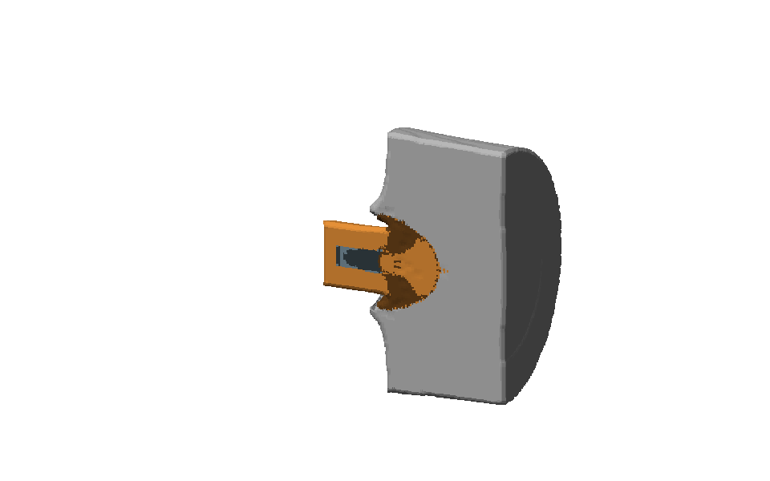

# Realistic armor penetration by SernikNaZimno

A physics simulator of armor penetration in which both the armor and the
penetrator deform. It uses the Material Point Method (MPM). Metals follow
Johnson–Cook strength and damage with a Mie–Grüneisen equation of state;
ceramics follow the Johnson–Holmquist JH-2 model with a polynomial equation
of state.

Built-in materials: 4340 steel, hardened shell steel, tungsten heavy alloy,
99.5 % alumina and inert TNT for the bursting charge of a shell.

Status: **M11 — everything on the GPU.** The armor can be an array of
plates or a solid of any shape read from an STL file, and every kind of
model and material runs on the CPU or on the GPU. See the
[user guide](docs/user-guide.md) for building, the desktop application, the
command line, the scenario file and how to read the results.

## Usage

```bash
cargo run --release -p rap-cli -- preset apfsds -o shot.json
```

```bash
cargo run --release -p rap-cli -- run shot.json
```

### Desktop application

```bash
cargo run --release -p rap-ui
```

- **Projectile:** APBC or APFSDS, dimensions, nose shape (flat, hemisphere,
  cone, ogive), optional ballistic cap, material and impact speed.
- **Armor:** obliquity; any number of layers with material, thickness and
  gap; and a face shape given as displacement of the face against distance
  from the shot line, which every layer follows.
- **Materials:** built-in materials can be copied and their equation of
  state, strength, damage and thermal properties edited; copies are stored
  in the scenario file.
- **Simulation:** solver (CPU or GPU), resolution, armor half-width,
  friction and simulated time.
- **View:** particles coloured by material, damage, plastic strain,
  pressure, temperature or speed; drag to pan, scroll to zoom, double-click
  to reset. An axisymmetric model is shown mirrored about its axis.
- **Results:** depth along the shot line over time, perforation, residual
  speed and mass, failed fractions.

Scenarios are opened and saved in the same JSON format the command line
uses.

Models are shown as shaded solids that can be turned and cut along the shot
line, in the window and in pictures written by `rap run --pictures`. A
152 mm shell with its bursting charge, stopped head-on in 300 mm of steel:



### Command line

`preset` writes an example scenario (`apbc` or `apfsds`) to edit; `materials`
lists the built-in materials; `run` simulates a scenario and writes
`summary.json` and `particles_NNNN.vtk` snapshots (for ParaView) into
`<scenario name>-results`.

`run --gpu` uses the GPU solver; so does `"backend": "gpu"` in the scenario's
settings.

A scenario file holds the projectile, the armor layers with their materials,
thicknesses and gaps, the obliquity and face shape, the impact speed, optional numerical
`settings` (resolution, simulated time, friction, number of snapshots) and
optional custom `materials`. Lengths are in metres, speeds in m/s and angles
in degrees.

A perpendicular impact is simulated axisymmetrically. An oblique impact is
simulated in three dimensions, as the half on one side of the plane through
the shot line and the plate normal; the view shows the cross-section in that
plane and the snapshots hold all particles. This is many times more
expensive than a two-dimensional model. Setting
`"oblique_model": "plane_strain"` selects the old approximation instead, in
which the projectile acts as a slab: cheap, and only indicative.

## Validation

The solver is checked against analytical solutions in
`crates/rap-solver-cpu/tests` (4 particles per cell):

| Case | Quantity | Simulated | Reference |
|---|---|---|---|
| Steel plates, ±500 m/s | shock pressure | 20.74 GPa | 20.80 GPa (Hugoniot) |
| | shocked density | 8637.5 kg/m³ | 8643.3 kg/m³ |
| | total energy drift | −0.13 % | 0 |
| Steel plates, ±5 m/s | elastic stress | 228.5 MPa | 228.2 MPa |
| | wave front after 2 µs | 11.4 mm | 11.7 mm |
| Taylor bar, plane strain, 200 m/s | final / initial length | 0.866 | 0.862 (Wilkins–Guinan estimate) |
| Taylor cylinder, axisymmetric, 200 m/s | final / initial length | 0.859 | 0.842 (Wilkins–Guinan estimate) |
| | total energy drift | −0.0001 % | 0 |
| Elastic bar striking an equal bar, 20 m/s | speed handed to the struck bar | 91 % | 100 % (1D wave theory) |
| | momentum drift | 10⁻¹⁴ | 0 |
| Tungsten rod, L/D = 10, into steel, 1500 m/s | penetration / rod length | 0.97 | 0.87 (Alekseevskii–Tate, Y_p = 1.5 GPa, R_t = 4.5 GPa) |
| | crater / rod radius | 1.9 | — |

The long-rod case uses 1 mm cells, so the rod is only four cells in radius;
the Tate strengths are estimates of the flow stress of the two alloys, not
fitted values.

## Full-caliber shells and contact

A full-caliber shell penetrates as a nearly rigid body, so how wide the
solver takes it to be matters. Bodies are in contact only at grid nodes
where their surfaces touch
([ADR 0006](docs/adr/0006-contact-only-where-bodies-touch.md)); without
that test they interact across a gap of about two cells and the depth never
settles. The 152 mm shell of the examples, of hardened shell steel, striking
thick 4340 steel head-on at 810 m/s:

| Cells per radius | 6 | 8 | 12 | 16 | 20 |
|---|---|---|---|---|---|
| Depth, contact wherever bodies share a node | — | 97 mm | 118 mm | 132 mm | 147 mm |
| Depth, contact where bodies touch | 127 mm | 148 mm | 166 mm | 166 mm | 170 mm |

The depth has settled by 12 cells per radius. The same shell with armor
steel instead of shell steel flattens against the plate and reaches about
two thirds of the depth.

Plates of finite thickness, at 12 cells per radius, against what the
[Wikipedia article on the ISU-152](https://en.wikipedia.org/wiki/ISU-152)
gives for the 48.78 kg armor-piercing shell of the same caliber:

| Gun | Quoted penetration of rolled armor at 90° | Speed assumed at that range | Simulated |
|---|---|---|---|
| ML-20S, 600 m/s at the muzzle | 125 mm at 500 m | 575 m/s | 125 mm perforated, with 41 % of the shell leaving at 71 m/s; 150 mm barely, 12 % at 43 m/s |
| BL-8, 850 m/s at the muzzle | 203 mm at up to 2000 m | 760 m/s | 203 mm barely perforated, 9 % at 52 m/s; 230 mm not |

No parameter was adjusted to obtain this. It is still weaker evidence than
it looks: the source is secondary, the speeds at range are estimates, the
steel parameters are not from primary sources, and close to the limit the
verdict depends on how much of the shell must emerge, and how fast, to
count as perforation.

Against 245 mm at a compound angle of 30° by 30°
([aphe-turret-cheek.json](docs/examples/aphe-turret-cheek.json)), at 8
cells per radius, the shell gouges the plate, breaks at the nose (49 % of
it failed after 1.1 ms) and does not get through. At the 4 cells per radius
of the example file the result is only indicative.

## Ceramics

In JH-2 the strength of a ceramic rises with pressure and falls from an
intact to a fractured curve as damage accumulates; fully fractured ceramic
still resists shear while it is confined and is loose rubble once the
pressure is gone. The solvers therefore treat failed ceramic differently
from failed metal, which flows freely.

Checked in the unit tests: built-in alumina compressed in uniaxial strain
first yields at a longitudinal stress within 2 % of its Hugoniot elastic
limit of 2.79 GPa, keeps a reduced strength after fracturing under
pressure, and carries neither shear nor tension once released. In a coarse
end-to-end run, a tungsten rod at 1500 m/s leaves 8 mm of steel at
1354 m/s and 8 mm of alumina on 8 mm of steel at 1201 m/s; there is no
reference value for that comparison.

The bulking pressure of the original model is not included.

## Three-dimensional solver

Checked in `crates/rap-solver-cpu/tests/solid.rs`:

| Case | Quantity | 3D | Reference |
|---|---|---|---|
| Steel plates, ±500 m/s | shock pressure | 20.82 GPa | 20.80 GPa (Hugoniot) |
| | total energy drift | −0.29 % | 0 |
| Taylor cylinder, 200 m/s, quarter model | final / initial length | 0.8654 | 0.8661 (axisymmetric solver) |
| | total energy drift | −0.0005 % | 0 |

The example [oblique-plate.json](docs/examples/oblique-plate.json), a
tungsten rod (8 mm by 48 mm) striking a 12 mm steel plate at 60° and
1500 m/s at 3 cells per radius, leaves with 92 % of its mass at 1139 m/s
in the three-dimensional model (50 916 particles, 46 s on the CPU) and
with 97 % at 1231 m/s in plane strain (2 216 particles, about a second).
There is no reference solution for this case; the difference only shows
that the plane-strain shortcut is not a substitute.

See [ADR 0003](docs/adr/0003-three-dimensional-models.md) for the design.

## Armor from STL files

The solid enclosed by an STL mesh, binary or text, is filled with particles
within the armor half-width of the shot line; the shot is placed by a point
and a direction in the coordinates of the file. The model is
three-dimensional and whole, since an arbitrary shape has no symmetry.

Checked in `crates/rap-geometry` and `crates/rap-app/tests/mesh_armor.rs`:
a box and an octahedron are filled to their volumes, also when lattice
lines pass exactly through edges and corners; a mesh with a hole is
refused; and a 6 mm plate given as a mesh and struck at 45° by a tungsten
rod at 1500 m/s lets it through at 1132 m/s, against 1140 m/s for the same
plate given as layers in the half model.

The example [cast-dome.json](docs/examples/cast-dome.json) fires an 8 mm by
48 mm tungsten rod at 1500 m/s into the 30 mm wall of a hollow steel dome,
off its axis, where the way through the wall is 31.5 mm. At 3 cells per
radius the model has 183 479 particles and takes 183 s on the CPU; the
rod leaves the wall with 80 % of its mass at 817 m/s. There is no reference
value for this case.

See [ADR 0004](docs/adr/0004-armor-from-stl-meshes.md) for the design.

## GPU solver

The GPU solvers implement the same schemes as the CPU solvers in single
precision, for every kind of model and material. On identical models the
two take the same number of steps and agree as follows
(`crates/rap-solver-gpu/tests`):

| Case | Quantity | GPU | CPU |
|---|---|---|---|
| Steel plates, ±500 m/s | shock pressure | 20.7397 GPa | 20.7397 GPa |
| Taylor cylinder, 200 m/s | final / initial length | 0.85891 | 0.85890 |
| Elastic bar collision, 20 m/s | struck bar speed | 18.240 m/s | 18.236 m/s |
| Tungsten rod into steel, 1500 m/s, 90 µs | depth | 46.303 mm | 46.303 mm |
| Rod into an alumina tile on steel, 4 µs | failed fraction of the tile | 0.3944 | 0.3944 |
| | mean equivalent stress in the tile | 270.08 MPa | 270.08 MPa |
| 3D: steel plates, ±500 m/s | shock pressure | 20.8177 GPa | 20.8176 GPa |
| 3D: rod into a plate at 45°, 16 µs | rod velocity | (903.6, −37.4, 23.9) m/s | (903.6, −37.4, 23.9) m/s |
| | failed fraction of the plate | 0.0859 | 0.0859 |

Time for the first 60 µs of the APFSDS preset on an AMD Radeon integrated
GPU against a 16-thread CPU:

| Cells per radius | Particles | CPU | GPU | Speed-up |
|---|---|---|---|---|
| 4 | 23 672 | 2.7 s | 2.0 s | 1.35 |
| 10 | 147 953 | 38.9 s | 22.3 s | 1.74 |
| 16 | 378 728 | 155.9 s | 90.1 s | 1.73 |

The three-dimensional examples, whole runs on the same machine:

| Example | Particles | CPU | GPU | Speed-up |
|---|---|---|---|---|
| `oblique-plate.json` | 50 916 | 46 s | 41 s | 1.12 |
| `cast-dome.json` | 183 479 | 183 s | 151 s | 1.21 |

In three dimensions every grid node gathers from 27 cells and a particle
is 144 bytes, so on an integrated GPU, which shares the memory of the
processor, the gain is small. A discrete GPU has not been tried.

The two-dimensional runs also show that the default resolution is coarse: the depth reached
after 60 µs is 39.9 mm at 4 cells per radius, 48.8 mm at 10 and 52.7 mm at
16, so results at the default setting are not converged.

See [ADR 0002](docs/adr/0002-gpu-solver.md) and
[ADR 0005](docs/adr/0005-three-dimensional-models-and-ceramics-on-the-gpu.md)
for the design.

## Known limitations

- Contact is detected on the grid, so bodies start to interact about one
  cell before they touch.
- Material parameters are literature values that have not been checked
  against a primary source.
- Fracture is local: there is no regularisation, so crack patterns depend on
  the grid.
- A material point fails completely the moment its tension passes the spall
  strength, so a rod that perforates a plate is reported as largely failed
  debris, and the mass counted behind the armor includes that debris.
- The bursting charge of a shell is inert: it does not detonate.
- Brittle fracture is local: a crack is one cell wide whatever the cell
  size, so the energy it takes depends on the grid.
- The GPU solver is not reproducible to the last digit from run to run.
- All armor layers are bonded to each other.
- Armor from an STL file is one material, and the piece of it that is
  modelled is not confined by the armor around it.
- The armor face shape is the same on both sides of the shot line, and in an
  axisymmetric model it is a surface of revolution.
- The desktop application reassembles the model after every edit, which
  becomes slow at high resolution.
- The three-dimensional view draws the surface as flat patches of about one
  and a half particle spacings, painted from back to front; it is as coarse
  as the model and has no perspective.
- A run cannot be paused and resumed from a file.
- The three-dimensional CPU solver has a serial particle-to-grid transfer.
- The GPU solver needs a Vulkan, DirectX 12 or Metal adapter, has only
  been run on one integrated AMD GPU, and is limited by the largest buffer
  the adapter allows: a three-dimensional particle takes 144 bytes. The
  largest model run so far has 2.3 million particles.

## Layout

| Crate | Responsibility |
|---|---|
| `rap-domain` | projectile, armor, layer, scenario, units |
| `rap-materials` | strength, equation of state and damage models |
| `rap-geometry` | parametric shapes, triangle meshes and particle sampling |
| `rap-solver` | solver abstraction |
| `rap-solver-cpu` | reference `f64` MPM solvers |
| `rap-solver-gpu` | `f32` MPM solvers in wgpu compute shaders, checked against the CPU solvers |
| `rap-analysis` | post-processing of results |
| `rap-render` | pictures: colours, surface of the particles, PNG output |
| `rap-io` | scenario files, STL meshes, VTK export |
| `rap-app` | use cases shared by the front ends |
| `rap-ui` | desktop interface (egui) |
| `rap-cli` | headless front end (`rap` binary) |

Dependencies point strictly downwards: front ends → `rap-app` → services → `rap-domain`.
Design decisions are recorded in [docs/adr](docs/adr).

## Development

```bash
cargo fmt --all --check
cargo clippy --workspace --all-targets -- -D warnings
cargo test --workspace
cargo run -p rap-cli
```

## Roadmap

- M0 — skeleton, lints, CI
- M1 — domain and material models
- M2 — 2D plane-strain CPU solver, validated with Taylor impact and plate impact
- M3 — 2D penetration: contact, damage, spall, axisymmetry, comparison with the Tate model
- M4 — scenario files (JSON), model assembly, CLI, VTK export
- M5 — desktop application: projectile, armor (layers and face shape) and material editors, particle view, results
- M6 — GPU solver for the two-dimensional models
- M7 — three-dimensional models on the CPU (true oblique impact)
- M8 — ceramics (Johnson–Holmquist JH-2)
- M9 — armor of any shape from STL files
- M10 — user documentation
- M11 — three-dimensional solver and ceramics on the GPU

- M12 — full-caliber shells with a bursting charge (APHE), inert
- M13 — three-dimensional view: shaded solids, section, orbiting camera
- M14 — contact only where bodies touch, a sound measure of depth, hardened
  shell steel
- M15 — pictures of a run from the command line, for films
- M16 — three-dimensional pictures of axisymmetric models
- M17 — brittle fracture by the largest principal stress; no limit on the
  number of particles on the GPU

Every milestone of the original plan is done. What would add most from here: a
leaner particle-to-grid transfer on the GPU, checkpoints, material
parameters checked against primary sources, and meshes with more than one
material.
